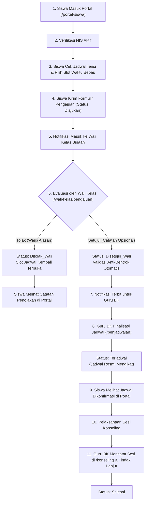

# DOKUMENTASI SISTEM SIRASI-BK
**Sistem Informasi Riwayat Administrasi dan Penjadwalan Bimbingan Konseling Siswa**  
**SMP Negeri 2 Dramaga, Kabupaten Bogor**

---

## 1. Pendahuluan & Gambaran Umum

SIRASI-BK adalah aplikasi berbasis web yang dikembangkan menggunakan **Laravel (PHP) dan MySQL** untuk mengelola layanan Bimbingan dan Konseling (BK) di SMP Negeri 2 Dramaga secara digital, terstruktur, aman, dan kolaboratif.

Sistem ini mentransformasikan alur kerja BK konvensional menjadi sistem **multi-peran terintegrasi** yang mencakup:
1. **Administrasi & Master Data**: Pengelolaan akun pengguna, data master siswa, dan kalender penjadwalan.
2. **Layanan Bimbingan Konseling**: Pencatatan sesi konseling kasus, tindak lanjut, pelaporan rekap masalah, dan penerbitan surat panggilan siswa.
3. **Persetujuan Bertingkat Wali Kelas**: Validasi pengajuan bimbingan siswa oleh Wali Kelas sebelum difinalisasi oleh Guru BK demi koordinasi akademik siswa.
4. **Validasi Anti-Bentrok Jadwal Guru BK**: Pencegahan jadwal ganda atau tumpang tindih waktu konseling dengan mekanisme penguncian transaksi basis data.
5. **Portal Mandiri Siswa**: Fasilitas bagi siswa untuk memeriksa ketersediaan slot Guru BK, mengajukan konseling mandiri dengan verifikasi NIS, dan memantau status persetujuan secara transparan.

---

## 2. Arsitektur Peran & Matriks Hak Akses (RBAC & Least Privilege)

Aplikasi menerapkan prinsip **Least Privilege** untuk menjamin kerahasiaan catatan kasus konseling siswa:

| Fitur / Modul | Admin (`admin`) | Guru BK (`guru_bk`) | Wali Kelas (`wali_kelas`) | Siswa (`siswa` / Portal) |
| :--- | :---: | :---: | :---: | :---: |
| **Login Sistem Bersama (`/login`)** | Ya | Ya | Ya | Dialihkan ke Portal |
| **Portal Pengajuan Mandiri (`/portal-siswa`)** | Publik | Publik | Publik | **Akses Penuh via NIS** |
| **Dashboard Khusus Peran (`/dashboard`)** | Statistik Pengguna & Master | Statistik Konseling & Metrik BK | Statistik Kelas Binaan & Jadwal | Dialihkan ke Portal |
| **Manajemen Akun Pengguna (`/users`)** | **CRUD Penuh** | Ditolak (403) | Ditolak (403) | Ditolak (403) |
| **Master Siswa (`/siswa`)** | **CRUD, Import, Toggle** | Baca & Tambah | Ditolak (403) | Ditolak (403) |
| **Detail Rekam Kasus Siswa (`/siswa/{id}`)** | Ditolak (403 Privasi) | **Akses Penuh** | Ditolak (403 Privasi) | Ditolak (403) |
| **Jadwal Konseling (`/penjadwalan`)** | **CRUD Jadwal** | **CRUD & Konfirmasi** | Ditolak (403) | Baca Slot via Portal |
| **Persetujuan Pengajuan (`/wali-kelas/pengajuan`)**| Ditolak (403) | Ditolak (403) | **Setujui / Tolak Kelasnya** | Status via Portal |
| **Pencatatan Konseling (`/konseling`)** | Ditolak (403 Privasi) | **CRUD Penuh** | Ditolak (403 Privasi) | Ditolak (403) |
| **Tindak Lanjut Konseling (`/tindak_lanjut`)** | Ditolak (403 Privasi) | **Akses Penuh** | Ditolak (403 Privasi) | Ditolak (403) |
| **Laporan & Surat Panggilan (`/laporan`)** | Ditolak (403 Privasi) | **Akses Penuh & PDF/DOCX**| Ditolak (403 Privasi) | Ditolak (403) |
| **Pengaturan Akun (`/pengaturan`)** | Profil & Password | Profil & Password | Profil & Password | - |

---

## 3. Alur Bisnis Layanan Bimbingan Konseling

Berikut adalah alur terpadu pengajuan konseling siswa hingga pelaksanaan sesi bimbingan:



---

## 4. Struktur Database & Model Utama

Sistem menggunakan database relasional MySQL `sirasi_bk` dengan tabel-tabel utama:

1. **`users`**:
   - `id_user` (PK, int)
   - `nama` (varchar 100)
   - `username` (varchar 50, unique)
   - `password` (varchar 255, bcrypt)
   - `role` (enum: `'admin'`, `'guru_bk'`, `'wali_kelas'`, `'siswa'`)
   - `id_kelas` (FK nullable ke `kelas.id_kelas`, khusus penugasan `wali_kelas`)
   - `foto_profil` (varchar 255, nullable)

2. **`kelas`**:
   - `id_kelas` (PK, int)
   - `nama_kelas` (varchar 20, misal: `'7.1'`, `'8.2'`, `'9.10'`)
   - `tingkat` (int: 7, 8, atau 9)

3. **`siswa`**:
   - `id_siswa` (PK, int)
   - `nis` (varchar 50, nullable/unique)
   - `nama_siswa` (varchar 100)
   - `jenis_kelamin` (enum: `'L'`, `'P'`)
   - `id_kelas` (FK ke `kelas.id_kelas`)
   - `alamat` (text, nullable)
   - `no_telp` (varchar 20, nullable)
   - `status` (enum: `'Aktif'`, `'Tidak Aktif'`)

4. **`penjadwalan`**:
   - `id_penjadwalan` (PK, int)
   - `id_siswa` (FK ke `siswa.id_siswa`)
   - `tanggal` (date)
   - `waktu_mulai` (time)
   - `waktu_selesai` (time)
   - `jenis_bimbingan` (varchar 255)
   - `catatan` (text, nullable)
   - `status` (enum: `'Diajukan'`, `'Disetujui_Wali'`, `'Ditolak_Wali'`, `'Terjadwal'`, `'Selesai'`, `'Dibatalkan'`)
   - `id_wali` (FK nullable ke `users.id_user`)
   - `waktu_persetujuan_wali` (timestamp, nullable)
   - `catatan_wali` (text, nullable)

5. **`jenis_masalah`**:
   - `id_jenis` (PK, int)
   - `nama_jenis` (varchar 100, misal: Pribadi, Belajar, Sosial, Karier)
   - `keterangan` (text, nullable)

6. **`konseling`**:
   - `id_konseling` (PK, int)
   - `id_siswa` (FK ke `siswa.id_siswa`)
   - `id_jenis` (FK ke `jenis_masalah.id_jenis`)
   - `tanggal` (date)
   - `masalah` (text)
   - `hasil_konseling` (text)
   - `catatan` (text, nullable)
   - `status` (varchar 30, default `'Proses'`)

7. **`tindak_lanjut`**:
   - `id_tindak_lanjut` (PK, int)
   - `id_konseling` (FK ke `konseling.id_konseling`, cascade delete)
   - `tanggal` (date)
   - `tindakan` (text)
   - `keterangan` (text)

8. **`notifikasis`**:
   - `id` (PK, bigint)
   - `judul` (varchar 255)
   - `pesan` (text)
   - `tipe` (varchar 50, misal: `'konseling'`, `'siswa'`, `'jadwal'`)
   - `dibaca` (boolean)
   - `id_konseling` (FK nullable ke `konseling.id_konseling`)

---

## 5. Algoritma Validasi Anti-Bentrok Jadwal Guru BK

Validasi anti-bentrok diterapkan pada method statis `Penjadwalan::findConflict()` di `app/Models/Penjadwalan.php`.

### Rumus Irisan Waktu
Dua sesi bimbingan pada tanggal yang sama dinyatakan bentrok jika:
$$\text{waktu\_mulai}_{\text{baru}} < \text{waktu\_selesai}_{\text{lama}} \quad \text{DAN} \quad \text{waktu\_selesai}_{\text{baru}} > \text{waktu\_mulai}_{\text{lama}}$$

Kondisi yang diizinkan (*Back-to-back*):
$$\text{waktu\_mulai}_{\text{baru}} = \text{waktu\_selesai}_{\text{lama}} \quad \text{atau} \quad \text{waktu\_selesai}_{\text{baru}} = \text{waktu\_mulai}_{\text{lama}}$$

### Status yang Mengunci Slot (*ACTIVE_STATUSES*)
Hanya jadwal dengan status aktif yang memblokir slot waktu:
- `'Diajukan'`
- `'Disetujui_Wali'`
- `'Terjadwal'`
- `'Selesai'`

Jadwal dengan status `'Ditolak_Wali'` atau `'Dibatalkan'` **tidak memblokir slot** dan langsung membebaskan waktu untuk pemesanan lain.

### Proteksi Konkurensi (*Race Condition*)
Setiap operasi pembuatan atau pembaruan jadwal dibungkus dalam `DB::transaction()` dengan `lockForUpdate()` untuk mencegah *double booking* ketika dua siswa atau staf mengakses slot yang sama secara bersamaan.

---

## 6. Peta Endpoint Rute Web (`routes/web.php`)

```text
/ (GET)                                 -> Redirect ke /login
/login (GET, POST)                      -> Form dan proses login staf sekolah
/logout (POST)                          -> Keluar sesi staf sekolah

PORTAL SISWA MANDIRI (Publik / Verifikasi NIS)
/portal-siswa (GET)                     -> Halaman utama portal siswa
/portal-siswa/login (POST)              -> Autentikasi NIS mandiri
/portal-siswa/logout (POST)             -> Selesai sesi portal siswa
/portal-siswa/ajukan (POST)             -> Kirim pengajuan konseling siswa

RUTE INTERNAL TERPROTEKSI (Middleware: auth)
/dashboard (GET)                        -> Dashboard sesuai peran (Admin / Guru BK / Wali Kelas)
/pengaturan (GET, PUT)                  -> Kelola profil dan password
/notifikasi/{id}/baca (GET)             -> Redirect aman berbasis hak akses notifikasi

KHUSUS ADMIN (Middleware: role:admin)
/users (Resource)                       -> CRUD Akun Pengguna

BERSAMA ADMIN & GURU BK (Middleware: role:admin,guru_bk)
/siswa (Resource, kecuali show*)        -> CRUD Data Master Siswa
/siswa/{id}/toggle-status (PATCH)       -> Aktifkan / Nonaktifkan Siswa
/siswa/import (POST)                    -> Import Siswa dari Excel
/penjadwalan (Resource)                 -> Pengelolaan Kalender Bimbingan

KHUSUS GURU BK (Middleware: role:guru_bk)
/siswa/{id} (GET)*                      -> Rekam Riwayat Konseling Siswa (Rahasia)
/riwayat-siswa (GET)                    -> Daftar Siswa Berriwayat Konseling
/siswa/{id}/surat-panggilan (GET)       -> Surat Panggilan Orang Tua (Min. 3 Sesi)
/siswa/{id}/surat-panggilan/pdf (GET)   -> Unduh PDF Surat Panggilan
/siswa/{id}/surat-panggilan/docx (GET)  -> Unduh DOCX Surat Panggilan
/konseling (Resource)                   -> Pencatatan Kasus & Hasil Konseling
/tindak_lanjut (Resource)               -> Tindak Lanjut Sesi Konseling
/laporan (GET)                          -> Rekapitulasi Laporan Konseling & Masalah

KHUSUS WALI KELAS (Middleware: role:wali_kelas)
/wali-kelas/pengajuan (GET)             -> Daftar Pengajuan Konseling Siswa Kelas Binaan
/wali-kelas/pengajuan/{id}/approve (PATCH) -> Setujui Pengajuan Konseling
/wali-kelas/pengajuan/{id}/reject (PATCH)  -> Tolak Pengajuan Konseling (Wajib Alasan)
```
