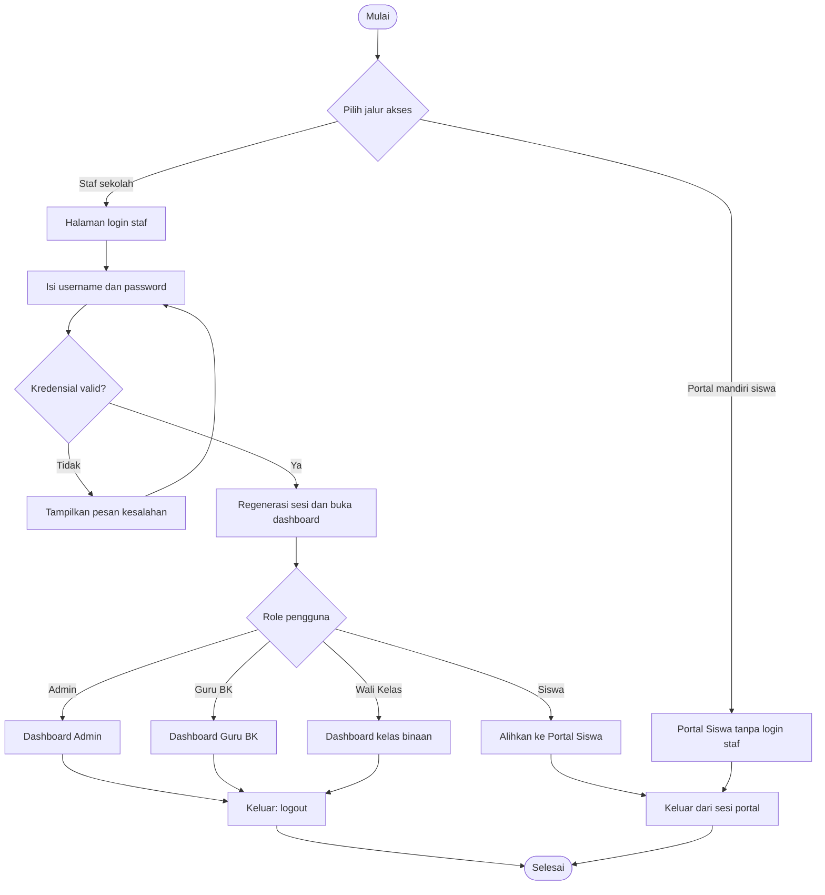
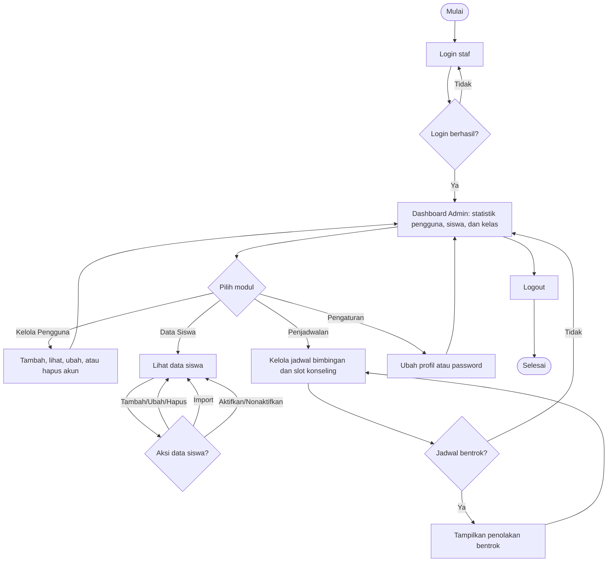
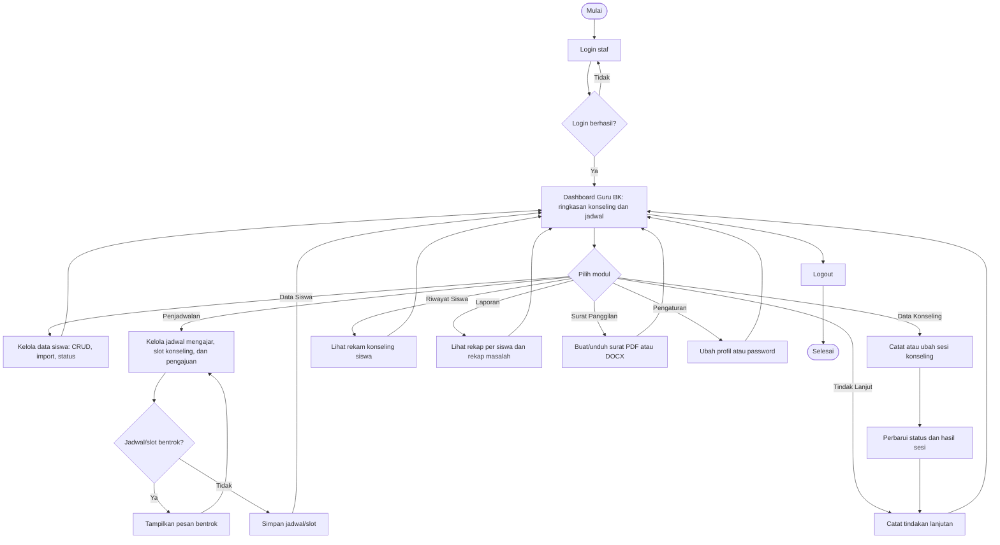
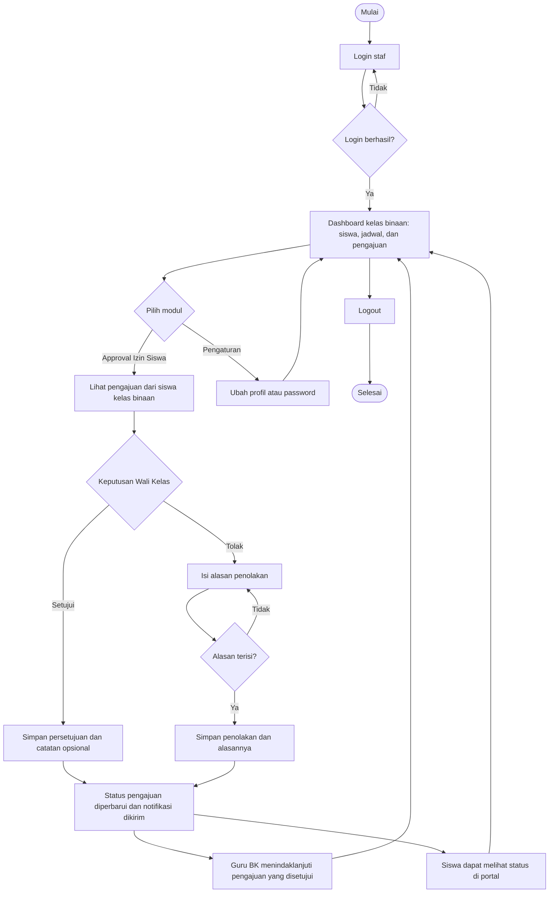
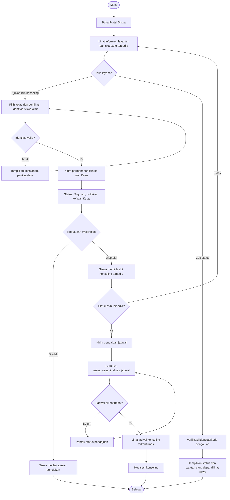
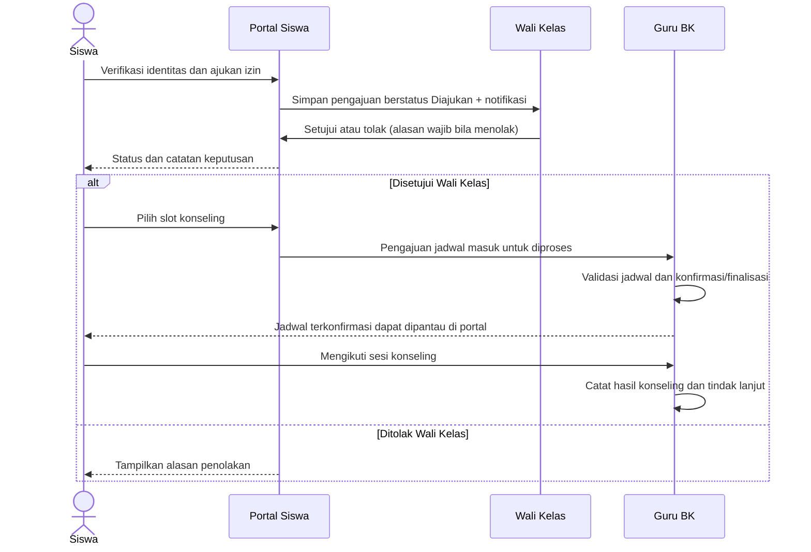

# Flowchart Sistem SIRASI-BK per Role

Dokumen ini merangkum alur aplikasi sesuai rute, middleware role, dan proses layanan yang tersedia. Diagram menggunakan Mermaid; buka file ini di editor/penampil Markdown yang mendukung Mermaid untuk melihat bentuk flowchart.

## 1. Alur Umum Autentikasi

> Akun siswa yang masuk melalui `/login` diarahkan ke portal. Siswa juga dapat memakai portal publik dan verifikasi identitas/NIS untuk mengajukan layanan.

## 2. Admin

Admin mengelola akun, data master siswa, serta penjadwalan. Data rekam kasus konseling tidak tersedia untuk Admin.

## 3. Guru BK

## 4. Wali Kelas

Wali Kelas hanya memproses pengajuan siswa yang berada di kelas binaannya; akses ke catatan pribadi konseling tidak diberikan.

## 5. Siswa (Portal Mandiri)

## 6. Ringkasan Alur Lintas-Role Pengajuan hingga Konseling

### Role dan hak akses utama

| Role | Alur utama |
| --- | --- |
| Admin | Dashboard, kelola akun pengguna, data siswa, penjadwalan, pengaturan akun |
| Guru BK | Data siswa, jadwal dan slot, rekam konseling, riwayat, tindak lanjut, laporan, surat panggilan |
| Wali Kelas | Dashboard kelas binaan, setujui/tolak pengajuan siswa kelasnya, pengaturan akun |
| Siswa | Portal publik, cek slot, ajukan izin/jadwal, dan cek status |

